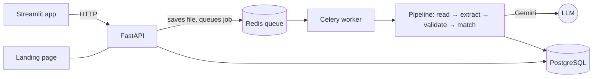

# SenseDoc: how it was built, step by step

This guide explains every part of SenseDoc in the order it was built, what each piece does, and why. It ends with a demo script and likely questions for a presentation.

---

## The idea in one sentence

**SenseDoc turns messy documents (invoices, receipts, price lists, phone photos) into validated, structured data using fields the user defines, and only asks a person about the values it is unsure of.**

```
Define template → Upload files → Read (text or image) → LLM extraction → Validate → Confidence
                                                                                     │
                                                         ┌───────────────────────────┴──────────┐
                                                   high confidence                       low confidence
                                                         │                                      │
                                                      Export  ◄─────────────────────────  Human review
```



| Layer | Tool | Job |
| --- | --- | --- |
| Schemas | Pydantic | Turn a user's template into a strict data model |
| LLM | Gemini via LangChain | Read the document and fill the model |
| Reading files | PyMuPDF, pandas, python-docx | PDF text and page images, Excel/CSV, Word |
| OCR | RapidOCR (ONNX, CPU) | Text and positions on photos and scans: source highlighting, confirming values |
| Checks | Our own validator | Grounding, required fields, sum rules, confidence |
| Matching | rapidfuzz | Tie each price to one exact product SKU |
| API | FastAPI | Upload, status, review, export, metrics |
| Jobs | Celery + Redis | Slow LLM work runs outside web requests |
| Database | PostgreSQL (SQLite locally) | Templates, documents, runs, values, reviews, products |
| UI | Streamlit + an HTML landing page | Everything a user clicks |
| Assistant | Gemini embeddings + LLM | Answers questions from the documents, with page citations |
| Quality | pytest + an evaluation script | Tests on every change; measured accuracy |
| Deploy | Docker Compose | One command starts the whole stack |

---

## Step 0: Project setup

- **uv** manages Python and packages. Each project has its own *virtual environment* (`.venv/`), so libraries never clash between projects.
- **Python 3.12**, not the newest 3.14, because AI and OCR libraries take time to support new Python versions.
- **Pydantic** is the foundation. You describe the *shape* data must have (`total_amount: float`), and Pydantic either converts the input to that shape or raises a clear error. LLM output can't be trusted, so everything the model returns passes through Pydantic.

## Step 1: First extraction (PDF → LLM → structured data)

- **PyMuPDF** reads the text out of a digital PDF.
- The API key lives in **`.env`**, never in code, and `.env` is in `.gitignore`.
- **`with_structured_output(Invoice)`** (LangChain) sends the Pydantic model's JSON schema to Gemini. The model must answer with exactly those fields and types, and we get a Python object back, not text to pick apart.
- Every field allows `None`, so the model can say "not shown" instead of inventing a value. Required fields are enforced later, by our own checks.

## Step 2: Templates become schemas at runtime

Users define their own fields, so we can't hand-write a class for every template.

- A template is plain data (JSON or a database row): field names, types (`text`, `number`, `date`, `currency`, `list`, `table`), required flags, descriptions and examples.
- `build_model()` (in `schema_builder.py`) uses Pydantic's **`create_model`** to build the class while the program runs. A `table` field calls `build_model` on its own columns (**recursion**), giving `list[Row]`.
- `to_key()` turns friendly names into Python names: `"Invoice Number"` → `invoice_number`.
- Descriptions and examples are put into the schema the model reads, so better descriptions mean better accuracy.

## Step 3: Any file type

`readers.py` returns a `ParsedDocument` holding **text and/or images**:

| File | How it's read |
| --- | --- |
| Digital PDF | Text per page (cheap and exact) |
| Scanned PDF page (less than 50 characters of text) | The page is rendered to a 200-DPI image |
| JPG / PNG / WEBP | Sent as an image |
| XLSX / CSV | Every sheet converted to CSV text (pandas) |
| DOCX | Paragraphs and tables as text (python-docx) |

**Rule: text if available, image if not.** Images cost more tokens, and text is exact. For images, Gemini is a **vision model**: it sees the layout, so it knows which price sits next to which product picture. The message to the model is **multimodal**: a list of text parts and base64-encoded images.

> OCR was added later, in Step 8b. The vision route stays the default because Experiment 1b measured it as the more accurate one on leaflets.

## Step 4: Validation, normalization and confidence

**Never trust the model blindly.** An LLM gives a confident-looking answer even when a photo is blurry. `validator.py` checks every value:

| Check | Question | Effect |
| --- | --- | --- |
| Grounding | Is this value actually printed in the document text? | Not found: −0.4 (likely hallucinated) |
| Image only | Was it read from a picture, with no text to cross-check? | Confidence set to 0.85 |
| Required | Is a required field missing? | Confidence 0 |
| Sum rules | Do line totals add up to the subtotal? Subtotal + tax = total? | Every value involved −0.3 |
| Normalization | Can `50cl` / `1.5L` be converted to ml? | Failure −0.3 |

A value **at or above 0.8 is auto-approved**. Below that, it goes to a person. Each value is checked on its own, so in a table each cell can be reviewed separately (`items[2].unit_price`).

Grounding compares the value in all the ways it might be printed (`12000.0` vs `12,000.00`, `2026-10-14` vs `14 October 2026`).

Why layered checks matter: if `4,200` is misread as `4,800`, grounding *passes*, because 4,800 appears elsewhere on the page. The **sum rule** catches it. No single check catches everything.

> The confidence numbers are rules, not probabilities. The evaluation measures **calibration** ("of auto-approved values, how many were right?") so the thresholds can be tuned with evidence.

Rules live **inside the template** (`"rules": [...]`), because every business has different rules.

## Step 5: Retries, fallbacks and cost tracking (`extractor.py`)

The plan's error-recovery chain, in code:

1. Ask the main model (`gemini-3.6-flash`).
2. If the answer is broken (bad JSON, wrong types), **re-prompt with the exact error**, up to 2 times.
3. If the model is down or overloaded, move to the **fallback model** (`gemini-3.5-flash`).
4. If the API says "too many requests" (rate limit), **wait and retry** instead of failing.
5. If everything fails, the document is marked `failed` with the reason. The job never crashes.

Every run records the model used, tokens in and out, **cost in USD**, latency and attempts.

## Step 6: Database and REST API

**Database (`db.py`)**: the plan's tables, defined with SQLAlchemy:

| Table | One row is... |
| --- | --- |
| `templates` / `template_fields` | a template version and its fields (table columns point to their parent field) |
| `documents` | an uploaded file, with status `queued → processing → needs_review / done / failed` |
| `extraction_runs` | one attempt: model, tokens, cost, latency |
| `extracted_values` | **one value** with its confidence, status, issues and matched SKU |
| `reviews` | an audit trail of every human approval or correction |
| `products` | the SKU catalogue, including aliases learned from corrections |

Editing a template **creates a new version**, so old results always match the template that produced them.

SQLite is used locally (no setup); Docker Compose switches to PostgreSQL by changing one setting, `DATABASE_URL`.

**API (`api.py`)**: FastAPI, with automatic interactive docs at `/docs`:

| Endpoint | Purpose |
| --- | --- |
| `POST /templates`, `GET /templates`, `PUT /templates/{id}` | Create, list, edit (new version) |
| `POST /documents` | Upload many files; returns at once and queues the work |
| `GET /documents/{id}` | Status, values, confidence, cost |
| `GET /documents/{id}/preview` | A PNG of the page, for the review screen |
| `GET /review-queue` | Values waiting for a person, oldest first |
| `PATCH /values/{id}` | Approve or correct (written to `reviews`) |
| `GET /templates/{id}/export?format=csv\|xlsx\|json` | Approved data |
| `GET /products`, `POST /products/import` | The SKU catalogue |
| `GET /metrics` | Auto-approval rate, latency, cost, evaluation results |

## Step 7: Background jobs (`worker.py`)

An LLM call takes 5–20 seconds. A web request must never wait that long. So the API only **saves the file and queues a job**, then answers immediately.

- With Docker, jobs go through **Redis** (the queue) to a **Celery worker** (the process that does the work). Workers can be scaled up for bulk uploads.
- Locally, without Redis, the same `process_document()` function runs in a FastAPI background task, so the demo needs no extra services.

`pipeline.py` holds that one function: **read → extract → validate → match products → save the run and every value → set the document status.**

## Step 8: Product and variant matching (`matching.py`)

On a leaflet that says "Coke", the price might belong to any of 9+ SKUs. The plan's rule: **never guess**.

1. **Saved alias?** If a reviewer already said what this exact wording means, use it.
2. **Filter by hard attributes**: brand (with aliases such as "Coke" → Coca-Cola), size in ml, pack type (can / PET / glass), pack count. Any that disagree are out.
3. **Rank by flavour** (Original, Zero Sugar, Diet...) using fuzzy text similarity.
4. **Decide:** exactly one SKU fits → matched. More than one → `needs_review` with the **top 3 candidates** and the reason ("size missing; 2 SKUs fit"). None → review.
5. **Unit price** for packs: ₦5,400 for 12 cans → ₦450 each.
6. **Learn:** when a reviewer picks a SKU, the wording is saved as an alias, so the same leaflet text matches automatically next time.

It reproduces the plan's worked example exactly: Coke 50cl auto-matched; Coke Zero can (no size) → review; Coke 35cl x12 → matched, ₦450/unit; bare "Coke" → review with candidates.

### Spelling first, meaning second

Fuzzy matching compares **letters**, so it can't tell that "Light" means the **Diet** SKU, or "Classic" means **Original**. Embeddings compare **meaning**, so they're asked only when spelling can't decide, after the hard filters have narrowed the list:

- Names are compared **with the brand** ("Coca-Cola Light" vs "Coca-Cola Diet"). Bare words were unreliable when measured: "Light" scored closer to *Orange* than to *Diet*.
- **Rule:** the best flavour must score at least 0.78 **and** beat the runner-up by 0.05. Then it's matched at confidence 0.82 (auto-approved, labelled "matched by meaning").
- **Only when there are at least two flavours to compare.** With one option left, "Fanta Citrus" scored 0.85 against Orange, higher than the true "Classic" → Original (0.84). No threshold can separate those, so a single option always goes to review.

Measured with real embeddings: Light → Diet ✓, Classic → Original ✓, Regular → Original ✓, while Cherry, Vanilla, Citrus and Pineapple (not in the catalogue) → review ✓. If embeddings are unavailable, matching works exactly as before.

## Step 8b: OCR and source highlighting (`ocr.py`)

Your plan asks to "show where every value came from". For that we need the **position** of every piece of text.

- **Digital PDFs** already store where each word is; PyMuPDF reads those positions directly.
- **Photos and scans** are only pixels, so we run **OCR** (optical character recognition). We use **RapidOCR**: the same kind of model as PaddleOCR, but packaged as small ONNX files that run on a normal CPU in about 3 seconds per page. It installs with pip, with no system packages and no GPU. Tesseract was the other option, but it needs an admin install and is weaker on receipts.
- Each line of text gets a **box** stored as fractions of the page (x0, y0, x1, y1 between 0 and 1), so it works at any image size.
- After extraction, `locate()` finds the line where each value is printed, and its page and box are saved in `extracted_values.page` / `bbox`, columns the plan already had.
- The preview endpoint draws an **orange box** around a value. In the app, click any value (Documents page) or pick one (Review queue) to see exactly where it came from.
- **A second opinion for photos:** a value Gemini read from an image that OCR also finds independently goes from 0.85 to 1.0 confidence. OCR can only raise confidence, never lower it.

### Experiment 1b: send the image, or send the OCR text?

Same 11 photos, same model (`gemini-3.5-flash-lite`):

| Route | Field accuracy | Median time | Cost per 1,000 pages |
| --- | --- | --- | --- |
| Vision (image) | 100% | 8.4 s | $4.29 |
| OCR text only | 98% | **2.1 s** | **$2.93** |

OCR text is 4× faster and about 30% cheaper, and it was perfect on invoices and receipts. **On the leaflet, though, it put prices on the wrong products**, and 2 wrong SKUs were auto-approved. OCR text loses the layout (which price sits under which picture), exactly as the plan predicted. So **vision stays the default**. A future "model routing" step could send clean invoices and receipts down the cheaper OCR route. Setting: `EXTRACTION_ROUTE=vision|ocr|hybrid`.

## Step 9: The user interface

**Landing page** (`web/index.html`, served at `/`): the problem, how it works, the variant-matching example, and **live evaluation numbers** loaded from `/metrics`.

**Web app** (Streamlit, `ui/`): multi-page, talking to the API over HTTP.

| Page | What it does |
| --- | --- |
| Overview | Key numbers and the six-step flow |
| Upload | Pick a template, drop many files, watch progress live (auto-refreshes every 3 seconds) |
| Documents | Every file with status, cost and time; the page preview beside its values and confidence bars |
| Review queue | Only uncertain values, shown **beside the page**; approve, correct, or pick the right SKU |
| Export | Preview, then download CSV / Excel / JSON |
| Templates | The **schema builder**: an editable table of fields, table columns, rules; saving creates a new version |
| Product catalogue | SKUs, learned aliases, CSV import |
| Ask your documents | Chat: questions answered from your files, with document and page citations |
| Metrics | Live usage plus evaluation results, including Experiment 1 |
| Label for testing | Check every value of a real document, fix mistakes, save it as a test label |

Streamlit reruns the page script on every click, so anything that must survive (like the list of just-uploaded files) is kept in `st.session_state`.

## Step 10: Testing and evaluation

**Tests (`tests/`, 23 tests, no API key needed):** run with `uv run pytest`. They cover template → schema, normalization, every validation case (correct, misread number, invented value, missing field, image), the plan's variant-matching examples, and the full API loop (upload → review → export) with the LLM replaced by a fake answer. They run in GitHub Actions on every push.

**Evaluation (`evaluation/`):**

- `make_dataset.py` generates **17 labelled documents** whose correct answers we know. Hard cases are included on purpose: invoices as clean PDFs **and** as tilted, blurred phone photos; receipt photos; two supermarket leaflets with look-alike traps (Zero vs Original, can vs bottle, 33cl vs 35cl, a missing size, a "33cl / 35cl – ₦280 / ₦300" line that must be split into two rows, single vs 12-pack).
- `run_eval.py` runs the real pipeline and scores field accuracy, accuracy of auto-approved values (calibration), review rate, row recall and precision, **variant accuracy**, latency and cost per 1,000 pages. It also runs **Experiment 1**: the same invoices via the text route vs the vision route.
- Results are written to `evaluation/RESULTS.md` and shown in the app and on the landing page.
- Free-tier Gemini keys allow about **20 requests per model per day**, so each document's result is cached in `evaluation/runs/`. A run cut off by the quota resumes where it stopped.

### Real documents: the numbers that matter

A perfect score on generated documents means the test set is too easy. The plan says *"Corrections in reviews double as new labelled data"*, so the app turns real files into test data:

1. Upload real files (phone photos of receipts, real supplier invoices, real leaflets).
2. **Label for testing** page: SenseDoc pre-fills every value; fix the wrong ones and click **Save as test label**. Each fix is also recorded as a review.
3. `uv run python evaluation/export_labels.py` copies labelled files and answers into `evaluation/real/` (git-ignored, because real invoices contain personal data).
4. `EVAL_SET=real uv run python evaluation/run_eval.py` writes `RESULTS_REAL.md`. Once it exists, the app and landing page show it instead of the synthetic results.

## Step 11: Knowledge assistant (`assistant.py`)

"Ask your documents": plain-language questions, answered **only** from your files.

1. **Index.** When a document is processed, its text is cut into page-sized chunks (at line breaks, so table rows stay whole) and each chunk is **embedded**: turned into a list of 768 numbers that captures its meaning (`gemini-embedding-001`). They are stored in the `chunks` table.
2. **Retrieve.** The question is embedded too. Chunks are scored by meaning (cosine similarity, 70%) plus shared keywords (30%), and the top 6 are kept. If embeddings are unavailable (quota), keyword matching alone still works.
3. **Answer.** Gemini gets the question, the numbered chunks and the document's **verified extracted values**, with strict rules: answer only from these, cite source numbers, and say "the documents don't say" otherwise. Citations the model invents (a source number that wasn't given) are dropped.

Tested: "What is the total due on invoice INV-2026-9313, and who is the supplier?" → *NGN 80,496.00, ADEBAYO SUPPLIES LTD* (cites invoice_00.pdf, page 1). "What is the warranty period for the fridge?" → *The documents don't say.*

**Where the vectors live:**

- **PostgreSQL (Docker or Supabase): pgvector.** The `embedding` column is a real `vector(768)` with an **HNSW index**, so the database finds the closest chunks itself (`ORDER BY embedding <=> question`), without loading every chunk. Databases created before this are upgraded automatically on startup; run *Index older documents* once afterwards.
- **SQLite (local runs):** SQLite has no vector type, so vectors are stored as JSON and compared in Python. That's fine for local use.

## Step 12: Security and privacy

- **API token** (`API_TOKEN` in `.env`): when set, every API call except the landing page, health check and published evaluation must send `Authorization: Bearer <token>`. The web app sends it automatically.
- **Web app sign-in** (optional): copy `.streamlit/secrets.toml.example` to `.streamlit/secrets.toml` with an OAuth client (for example Google), and the app requires sign-in through Streamlit's built-in `st.login`. Reviewer names then come from the signed-in account.
- **Retention** (`RETENTION_DAYS`): uploaded files older than N days are deleted at startup; extracted data and the review trail are kept.
- Real evaluation files, `.env` and secrets are git-ignored.

## Step 13: Supabase (hosted database + file storage)

Supabase is **hosted PostgreSQL with pgvector built in**, plus file storage. SenseDoc uses it with no code changes, only settings:

1. Create a project at supabase.com (pick the region closest to your users).
2. *Project Settings → Database → Connection string → **Session pooler***, and put it in `.env` as `DATABASE_URL=postgresql://...` (SenseDoc adds the driver name itself). The session pooler works on IPv4 networks; SenseDoc also turns off prepared statements so the transaction pooler works.
3. *Project Settings → API*: put the **Project URL** in `SUPABASE_URL` and the **service_role / secret key** in `SUPABASE_SERVICE_KEY`. This key bypasses Supabase's access rules, so keep it server-side only, never in the UI or in git.
4. Start the API. On first start it enables pgvector, creates the tables and index, loads the templates and catalogue, and creates a private `documents` bucket. Uploaded files are stored there as `supabase://documents/<id>.pdf`.

Without `SUPABASE_URL`, files stay on local disk. Supabase doesn't provide Redis, so a hosted version still needs one for Celery (for example Upstash, or the Redis add-on on Render or Railway).

**Free tier limits to know:** 500 MB of database storage and 1 GB of files, and projects **pause after a week of inactivity**. That's fine for a demo; move to a paid plan before real customer data.

## Step 14: Deployment

`docker compose up --build` starts **PostgreSQL, Redis, the API, a Celery worker and the UI**. One image serves all three app roles. Only the start command differs.

Verified: in the full stack, an uploaded invoice photo went through Redis to the Celery worker, was extracted, OCR-located (14 of 14 values) and saved in PostgreSQL in 10.8 seconds. To put it online, run the same `docker-compose.yml` on any VPS, or deploy the image to Render or Railway with a managed PostgreSQL and Redis.

---

## Running it

```bash
uv sync                                   # install everything
uv run uvicorn sensedoc.api:app           # terminal 1: API + landing page → http://localhost:8000
uv run streamlit run ui/app.py            # terminal 2: web app → http://localhost:8501
uv run pytest -q                          # tests
uv run python evaluation/run_eval.py      # accuracy run (uses the Gemini key)
```

On first start, the API creates the database and loads three ready-made templates (Supplier Invoice, Shop Receipt, Product Price List) and a sample product catalogue.

## Demo script (about 5 minutes)

1. **Landing page** (`localhost:8000`): the problem, how it works, the Coke variant table, the measured results.
2. **Templates → View "Product Price List"**: point out that fields are just data, the `Size` field normalizes to ml, and rows are matched to the catalogue.
3. **Upload**: choose *Supplier Invoice* and drop `samples/demo/invoice_00.pdf` and `invoice_01_photo.png` (a tilted, blurred photo). Then *Product Price List* with `samples/demo/leaflet_01.png`. Watch the statuses change live.
4. **Documents**: open the photo invoice. All values are found, at 0.85 confidence because they came from an image. Show cost (under one US cent) and time.
5. **Review queue**: the leaflet's "Coke Zero Can" has no size printed. SenseDoc did not guess: it offers 33cl and 35cl. Pick one and explain it is now **learned** (show it under *Product catalogue → learned aliases*).
6. **Documents → click a value**: the orange box shows exactly where it came from on the page (source highlighting).
7. **Export**: download Excel. One row per product line, with SKU and unit price.
8. **Ask your documents**: "What is the total due on invoice …?" (answer with a page citation), then something not in the files (it says so instead of inventing).
9. **Metrics**: accuracy, plus Experiment 1b: why we send images, not OCR text, for leaflets.

## Likely questions

- **"What if the model makes something up?"** Every value is checked against the page (grounding) and against sum rules. Invented values score low and go to review. Values with no text to check (photos) never get full confidence.
- **"How do you know it's accurate?"** A labelled test set with deliberately hard cases, re-run on every change. We report the accuracy of the values we auto-approve, not just overall accuracy.
- **"What does it cost?"** Tokens are counted per run. Costs are configured in `.env` (the default assumes $1.50 / $7.50 per million input/output tokens; check Google's pricing page). That's well under one US cent per page.
- **"Why not just OCR?"** We measured it (Experiment 1b). OCR text is 4× faster and 30% cheaper, but on a leaflet it put prices on the wrong products. So we send the image, and use OCR for positions (highlighting) and as an independent check.
- **"What about privacy?"** Keys stay in `.env`; files are stored locally or in a private volume. Still to do: encryption at rest, automatic deletion after a retention period, and authentication.

## What's not built yet

| Item | Status |
| --- | --- |
| A real evaluation set (150–200 real documents) | The tooling is built (Label for testing → export → `EVAL_SET=real`); the documents need collecting |
| Hosted deployment | Docker image builds; needs a hosting account (Render, Railway or a VPS) |
| Document classification, model routing, webhooks | Later phase in the plan; Experiment 1b gives the data for routing |
| Langfuse tracing | Not added; cost and latency are tracked in our own tables |
| Supabase project | The code is ready (Step 13); create the project and add its keys to `.env` |
| Database migrations (Alembic), file encryption at rest | Needed before scaling a public version; new tables were added without needing migrations so far |
| Demo video and write-up | Launch deliverables, best recorded by you |
